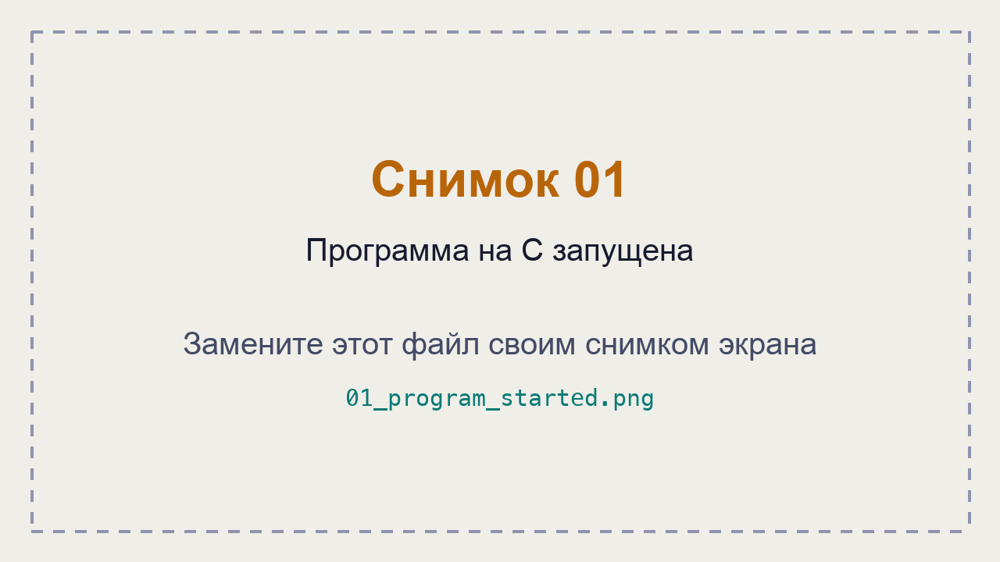
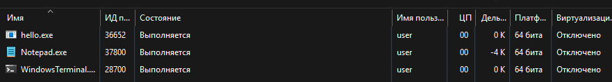
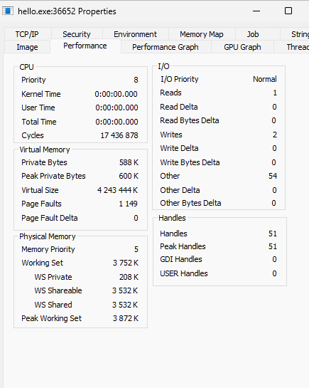
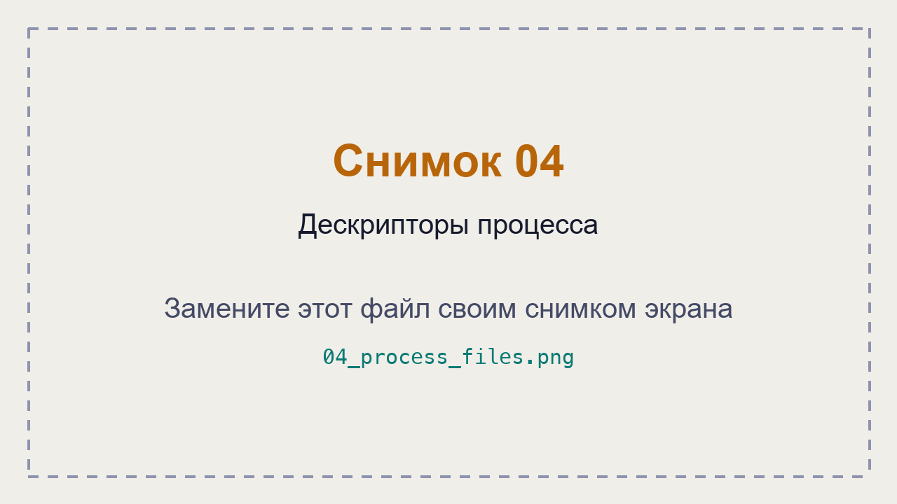
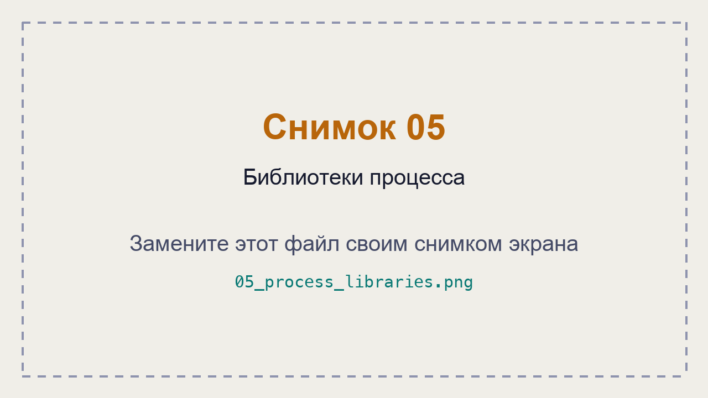
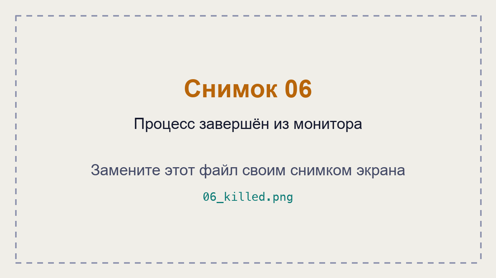
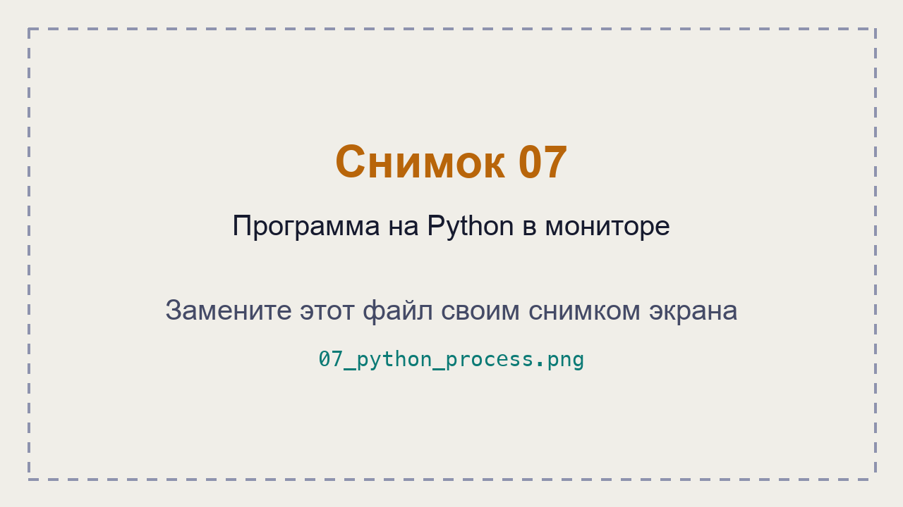
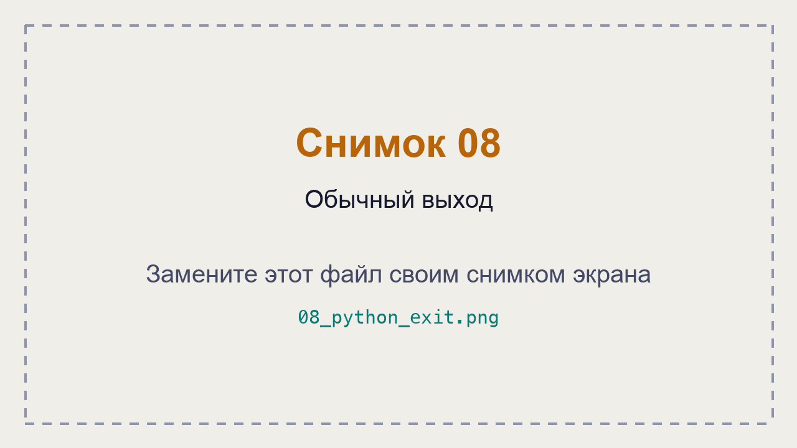

# ЛР 1. Процесс изнутри

Система: windows · компилятор: Оптимизирующий компилятор Microsoft (R) C/C++ версии 19.44.35228 для x86

## Программа на C
Программа напечатала PID 36652, монитор показал PID 36652.
Память процесса в мониторе: 3,7 МБ. Процессорное время: Не увеличивается.
Пока программа ждёт Enter, процессорное время не растёт, потому что.
Дескрипторов у процесса: 62. Ввод и вывод ведут в стандартные потоки.
Системные библиотеки в процессе: kernel32.dll, KernelBase.dll, ntdll.dll, wow64.dll, wow64cpu.dll, wow64win.dll.
После завершения из монитора терминал напечатал код завершения 0.

Не получилось: все получилось

## Снимки экрана

Сохраните снимок поверх заглушки в папке `screenshots/` с тем же именем — ссылки ниже менять не нужно.

### 1. Программа на C запущена
Шаг 1. Видно: команда сборки и строка `agent v0, pid=…` в терминале.

### 2. Свой процесс в мониторе
Шаг 3. Видно: строка процесса `hello` с тем же номером, что напечатала программа.

### 3. Свойства процесса
Шаг 4. Видно: окно процесса `hello`: номер, память, процессорное время.

### 4. Дескрипторы процесса
Шаг 5. Видно: открытые файлы или дескрипторы: папка программы и устройство терминала.

### 5. Библиотеки процесса
Шаг 6. Видно: загруженные библиотеки (в Linux — карта памяти).

### 6. Процесс завершён из монитора
Шаг 8. Видно: терминал после завершения: сообщение оболочки и код завершения.

### 7. Программа на Python в мониторе
Шаг 9. Видно: строка `agent v0 (python), pid=…` и процесс Python с тем же номером.

### 8. Обычный выход
Шаг 11. Видно: терминал после Enter: код завершения 0.

