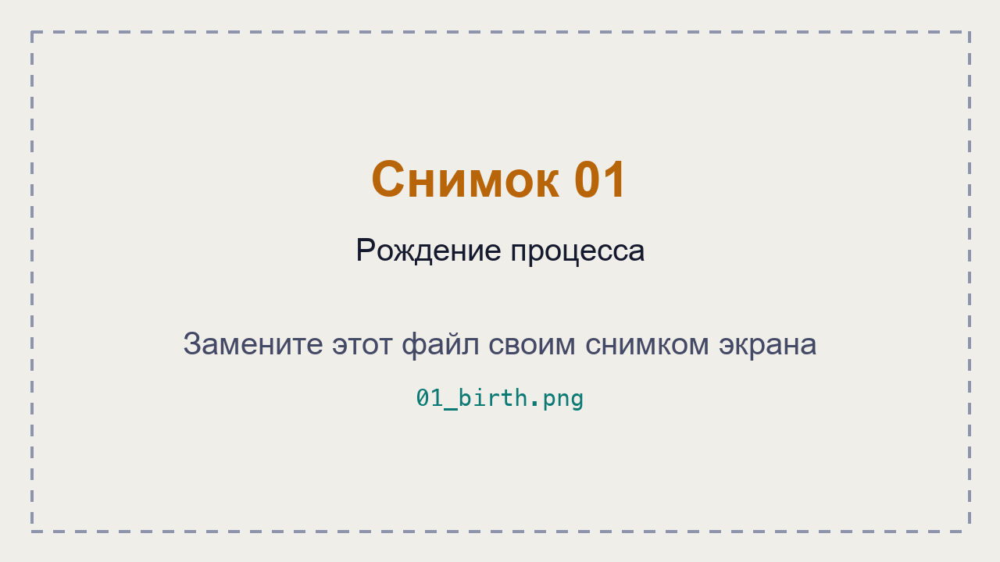
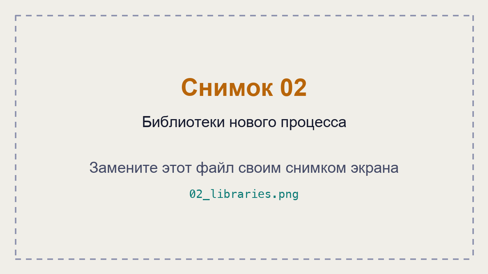
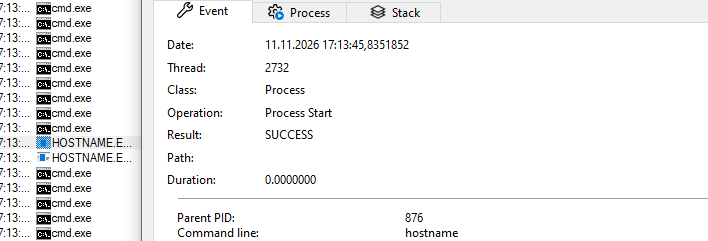
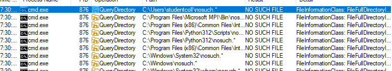
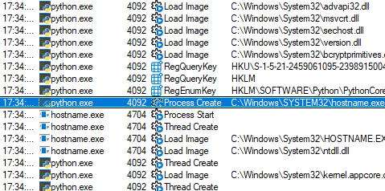

# ЛР 5. Рождение процесса

Система: Windows 
Программа записи: Process Monitor

## Рождение
Родитель (имя и номер): explorer.exe(13216)
Номер нового процесса: 876
Событие или вызов, которым создан процесс: Process Create
Библиотек загружено и первая из них: 3

## Запуск из Python
Номер Python и номер ребёнка: 4092
Чем запуск из Python отличается от запуска из оболочки: При запуске из Python родительским процессом является python.exe, а при запуске из командной оболочки родителем выступает cmd.exe. В обоих случаях создаётся отдельный дочерний процесс.

Не получилось: все получилось

## Снимки экрана

Сохраните снимок поверх заглушки в папке `screenshots/` с тем же именем — ссылки ниже менять не нужно.

### 1. Рождение процесса
Шаг 1. Видно: запись запуска `hostname`: родитель создаёт процесс, у нового процесса номер родителя.

### 2. Библиотеки нового процесса
Шаг 2. Видно: библиотеки, которые загрузил `hostname`, и первая из них.

### 3. Код завершения 7
Шаг 3. Видно: завершение ребёнка с кодом 7 и тот же код у родителя.

### 4. Программы нет
Шаг 4. Видно: поиск `nosuch` по папкам из PATH и ошибка «не найдено».

### 5. Запуск из Python
Шаг 5. Видно: Python создаёт процесс `hostname`: номер Python и номер ребёнка.

