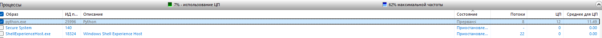
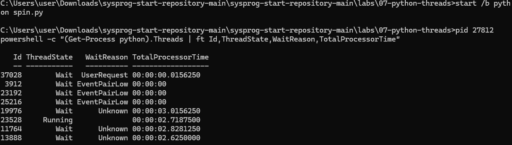
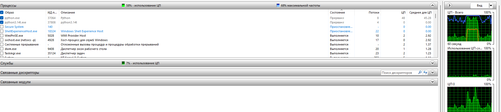
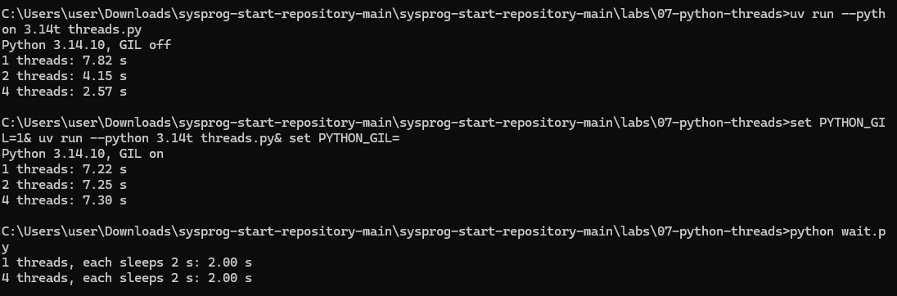

# ЛР 7. Потоки Python и GIL

Система: Windows 
Ядер (логических процессоров): 4
Версии Python (обычный и без GIL): 3.14.0

## Python с GIL
Процент процесса и число потоков: 7% и 1
Сколько потоков выполняется одновременно: 1

## Python без GIL
Процент процесса и проценты потоков: 53% / 40.23% и 1.37%

## Время работы
С GIL, 1 / 2 / 4 потока: 7.62s / 4.15s / 2.57s
Без GIL, 1 / 2 / 4 потока: 7.22s / 7.25s / 7.30s
Без GIL с PYTHON_GIL=1: 7.22s / 7.25s / 7.30s
Ожидание, 1 и 4 потока: 2.00s / 2.00s
Почему ожидающие потоки ускоряются и с GIL: Операции ввода-вывода (sleep) освобождают GIL, позволяя другим потокам выполняться.

Не получилось: все получилось 

## Снимки экрана

Сохраните снимок поверх заглушки в папке `screenshots/` с тем же именем — ссылки ниже менять не нужно.

### 1. Четыре потока с GIL
Шаг 1. Видно: процесс Python в мониторе: его процент и число потоков.

### 2. Потоки процесса
Шаг 2. Видно: список потоков процесса: сколько выполняется, сколько ждёт.

### 3. Четыре потока без GIL
Шаг 3. Видно: процесс python3.14t в мониторе: его процент.

### 4. Время работы
Шаг 4. Видно: вывод threads.py в Python с GIL и без.

